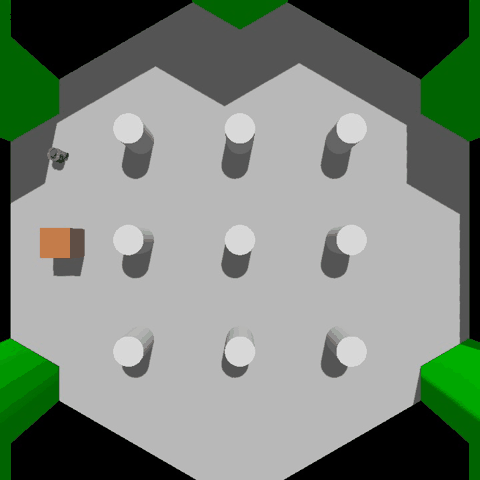
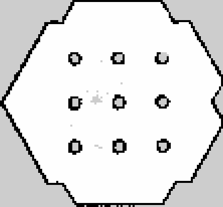

# turtlebot3-port-patrol

A ROS 2 waypoint patrol node integrated with SLAM and Nav2, in simulation.

A TurtleBot3 robot in Gazebo builds a map of its world with SLAM, then uses
Nav2 to visit three waypoints (A → B → C) one goal at a time. A small Python
node sends the goals, handles failures and timeouts, skips waypoints it
cannot reach, and prints a summary. I tested it with a clear route, with an
obstacle on the route that is not in the map, and with an unreachable
waypoint.

This was a one-week project to learn ROS 2 basics.



*Overhead view of one patrol run at 12× real time. Each red ring is the area
where Nav2 counts a goal as reached (0.25 m). The orange box was added after
mapping, so Nav2 only sees it through the LiDAR.*

## What is existing software and what is mine

Most of this project sets up, connects and tests existing open-source software.

| Part | Source |
|------|--------|
| Robot model, Gazebo world, keyboard teleop | [TurtleBot3](https://emanual.robotis.com/docs/en/platform/turtlebot3/overview/) (ROBOTIS) |
| Simulator | Gazebo Harmonic via `ros_gz` |
| Mapping (SLAM) | [SLAM Toolbox](https://github.com/SteveMacenski/slam_toolbox) |
| Localization (AMCL), path planning, path following, recovery behaviours | [Nav2](https://docs.nav2.org/) |
| Python interface for sending goals (`goToPose()`) | `nav2_simple_commander` (part of Nav2) |
| Nav2 parameters | TurtleBot3's `burger.yaml`, with one value changed (see below) |

**Code:**
- The patrol node, `src/port_patrol/port_patrol/patrol_node.py`. Written with AI assistance and explained to me block by block.
- The obstacle box model (`sim/obstacle_box.sdf`) and the demo recording
  tools (`sim/demo_camera.sdf`, `sim/record_demo.py`).
- During mapping I found the keyboard teleop hard to control, so the robot
  was driven around the arena by a short script that sent slow
  velocity commands.

**My part:**
- Setting up ROS 2 Jazzy, Gazebo, SLAM Toolbox and Nav2 on WSL2.
- Running the SLAM mapping, saving the map, and running Nav2 on it.
- Choosing the waypoints, writing the waypoint parameter file, building and
  running the package.
- Running all the tests and recording the results.
- Debugging, including the problem described below.

## How it works

1. **Mapping.** SLAM Toolbox combines the LiDAR scans and wheel odometry into
   an occupancy grid map (5 cm cells: free, occupied or unknown). The saved
   map is in `maps/`.

   

2. **Localization.** Nav2 loads the map, and AMCL estimates where the robot
   is on it, starting from an initial pose given at the spawn point.
3. **Patrol.** The node reads waypoint names and coordinates from
   `src/port_patrol/config/waypoint.yaml` (ROS 2 parameters). For each
   waypoint it:
   - sends one `NavigateToPose` goal with `goToPose()` (one goal at a time,
     not `followWaypoints()`, so the patrol logic stays in the node)
   - waits for the result and logs the remaining distance every 2 s
   - cancels the goal if there is no result within `goal_timeout_sec`
     (default 120 s) and marks it `TIMEOUT`
   - on `FAILED`, `CANCELED` or `TIMEOUT`, logs a warning and moves on to
     the next waypoint instead of stopping
4. **Summary.** At the end it prints each waypoint's result, how many were
   reached, and the total time.

Nav2 plans the path between waypoints and avoids obstacles. The node only
decides where to go, in what order, and what to do when a goal fails.

## Test results

Full details and logs: [docs/TEST_RESULTS.md](docs/TEST_RESULTS.md).

| Test | Setup | Result |
|------|-------|--------|
| 1. Clear route | No extra obstacles | 3/3 reached, 128.7 s |
| 2. Obstacle on route | 0.3 m box on the B → C route, not in the map | 3/3 reached in all 3 runs. The robot went around the box: the planned B → C path was 1.71 m instead of 1.46 m |
| 3. Unreachable waypoint | Box placed on top of B, timeout set to 60 s | A reached, B `TIMEOUT` and skipped, C reached: 2/3, 105.6 s |

**Limits:** few runs per test, one obstacle size, simulation only (Gazebo ran
at about 50–75 % of real time on my laptop). I have not seen the case where
Nav2 itself returns `FAILED`: in Test 3 the node's timeout fired first.

## A real problem I hit

**Symptom:** Nav2 planned a path, but the robot did not move. The recovery
counter in RViz went up to 6 and the log said `Failed to make progress`.

**Cause:** Gazebo runs slowly on my laptop, so LiDAR scans arrived only about
every 0.6 s. Nav2's `collision_monitor` (the last safety check before speed
commands reach the wheels) treats scans older than 0.2 s as stale. It
printed `Ignoring the source` over a thousand times and blocked every
command.

**Fix:** I copied TurtleBot3's Nav2 parameter file to
`config/nav2_burger.yaml` and changed `collision_monitor`
`scan.source_timeout` from 0.2 s to 2.0 s. Changing it at runtime with
`ros2 param set` reported success but had no effect, because the node only
reads it at startup.

The trade-off: on a real robot, a 2 s timeout would let it act on old
sensor data, which is unsafe. Here it only makes up for a slow simulator.

## How to run

Tested on Ubuntu 24.04 (WSL2) with ROS 2 Jazzy.

```bash
sudo apt install ros-jazzy-desktop ros-jazzy-turtlebot3* ros-jazzy-navigation2 \
  ros-jazzy-nav2-bringup ros-jazzy-slam-toolbox ros-jazzy-ros-gz
echo 'export TURTLEBOT3_MODEL=burger' >> ~/.bashrc

git clone https://github.com/ELARA-sys/turtlebot3-port-patrol.git
cd turtlebot3-port-patrol
colcon build --packages-select port_patrol
```

Use one terminal per command, and `source /opt/ros/jazzy/setup.bash` in each.

```bash
# 1. Simulation
ros2 launch turtlebot3_gazebo turtlebot3_world.launch.py

# 2. Nav2 with the saved map and the adjusted parameters
ros2 launch turtlebot3_navigation2 navigation2.launch.py use_sim_time:=True \
  map:=$PWD/maps/my_map.yaml params_file:=$PWD/config/nav2_burger.yaml

# 3. As soon as RViz opens: initial pose at the spawn point (= map origin)
ros2 topic pub --times 3 -r 1 /initialpose geometry_msgs/msg/PoseWithCovarianceStamped \
  "{header: {frame_id: map}, pose: {pose: {position: {x: 0.0, y: 0.0}, orientation: {z: 0.0, w: 1.0}}, covariance: [0.25,0,0,0,0,0, 0,0.25,0,0,0,0, 0,0,0,0,0,0, 0,0,0,0,0,0, 0,0,0,0,0,0, 0,0,0,0,0,0.0685]}}"

# 4. Patrol
source install/setup.bash
ros2 run port_patrol patrol_node --ros-args \
  --params-file src/port_patrol/config/waypoint.yaml -p use_sim_time:=true
```

Optional obstacle for Test 2 (Gazebo coordinates = map coordinates + (−2.0, −0.5)):

```bash
ros2 run ros_gz_sim create -world default -name obstacle_box \
  -file sim/obstacle_box.sdf -x -0.03 -y 1.87 -z 0.2
```

## Repository layout

```
config/nav2_burger.yaml          Nav2 parameters (TurtleBot3 copy, one change)
maps/                            Saved SLAM map (.pgm + .yaml)
src/port_patrol/                 ROS 2 Python package
  port_patrol/patrol_node.py     Patrol node
  config/waypoint.yaml           Waypoints A, B, C
sim/obstacle_box.sdf             Obstacle used in Tests 2 and 3
sim/demo_camera.sdf              Overhead camera for the demo GIF
sim/record_demo.py               Records the camera and builds the GIF
docs/TEST_RESULTS.md             Test setup, logs and results
docs/demo.gif, docs/map.png      Demo and map images
```

## Licences

TurtleBot3, Nav2 and SLAM Toolbox are open source under their own licences
(Apache-2.0 for TurtleBot3 and Nav2, LGPL-2.1 for SLAM Toolbox).
`config/nav2_burger.yaml` is a modified copy of TurtleBot3's `burger.yaml`.
